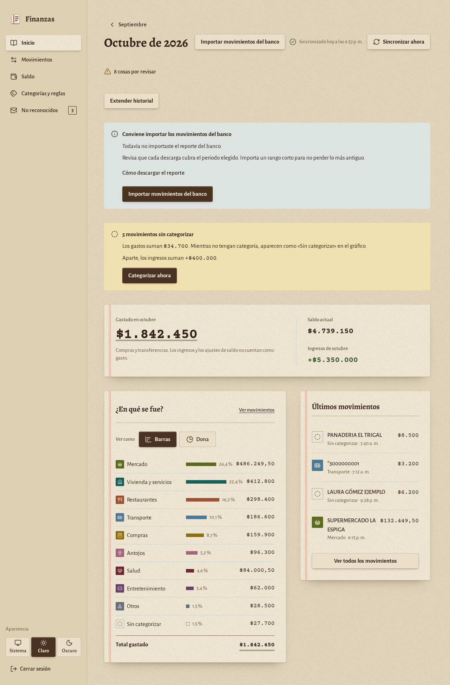

# Finanzas personales OSS

An early-beta, self-hosted personal finance app for Bancolombia notification
emails and downloaded transaction reports. The interface is in Spanish and
amounts use Colombian pesos (integer cents internally).

**Status:** independent release candidate prepared from a private personal
project. The maintainer reports three private beta testers over approximately
two weeks. This is preliminary feedback, not independently verified adoption,
external OSS contributions or demonstrated ecosystem dependence. See
[project origin](docs/ORIGIN.md) and [known limitations](SECURITY.md).

**En español:** una app para registrar movimientos, categorizar gastos y
conciliar avisos con reportes del banco en una instancia propia. Empieza por
[la instalación](docs/INSTALACION.md) o prueba la demo local con datos inventados.



*Local demo with invented names, transactions and balances. Generated for this
release candidate; it contains no tester or production records.*

## What it does

- Parses supported purchase, transfer, income, cash withdrawal, QR and PSE alerts.
- Groups/categorizes transactions with configurable rules and tracks a balance.
- Reads the supported Bancolombia XLSX export and previews reconciliation before
  confirmation; ambiguous matches remain explicit decisions.
- Uses SQLite with twelve explicit Alembic migrations, transactional updates,
  import history and guarded undo.
- Provides a typed FastAPI API, React interface and installable PWA. Its service
  worker caches the static shell rather than financial API responses.

The app reads inputs; it does not initiate bank payments or transfers.
It requires neither bank-login credentials nor an Anthropic/API subscription.
Gmail integration is optional and requires the user's own Google OAuth setup.

## Quick start: synthetic local demo

Requirements: Ubuntu/Linux, Python **3.12**, Node **24** and npm.
Windows can run part of development, but POSIX permissions, backups and
migration commands must be validated on Linux.

```bash
python3.12 -m venv .venv
. .venv/bin/activate
python -m pip install -c backend/constraints-linux-py312.txt -r backend/requirements-dev.txt -e .
cd frontend
npm ci --ignore-scripts
npm run build
cd ..
python scripts/servidor_e2e.py --puerto 8123
```

Open http://127.0.0.1:8123/app/ and use the synthetic demo password listed in
[the installation guide](docs/INSTALACION.md#demo-local). This demo creates a
temporary database and uses fake Gmail. Keep it on loopback and use synthetic
data only: it has testing/reset endpoints and is not the production server.

For real use follow [configuration and migrations](docs/INSTALACION.md) and
[personal Gmail authorization](docs/GMAIL.md). The deployment scripts in
[deploy/](deploy/GUIA.md) are optional Linux examples; inspect commands before
using them on your own server.

## Scope and limitations

One owner, one bank format family, one application worker. No multi-tenant
isolation, bank certification, complete accounting guarantees or PostgreSQL
support is claimed. Formats may change. The oldest day of an imported report
is treated conservatively because report completeness cannot be established.
Review reconciliation decisions and verify the resulting balance yourself.

## Development and design

See [CONTRIBUTING.md](CONTRIBUTING.md) for backend, frontend and browser tests.
The public workflow requires no private denylist or account credentials.
[Architecture](docs/arquitectura.md): six modules (Categories, Transactions,
Balance, Synchronization, Imports, Session), composition and use-case flows.
[Frontend](frontend/README.md): app/features/shared layers, generated API types,
design tokens and self-hosted fonts.

Historical screenshots, bank exports, private history and agent-session
configuration are intentionally absent from this independent snapshot. Browser
tests can regenerate synthetic screenshots locally with `npm run capturas`.

## License

Original code: [MIT](LICENSE). Fonts, icons and dependencies retain their own
licenses; see [third-party notices](THIRD_PARTY_NOTICES.md). This project is
independent of Bancolombia and does not imply its endorsement.
