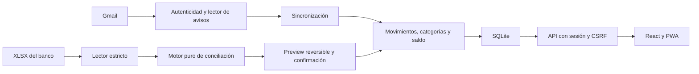

# Arquitectura

La app es un monolito modular con FastAPI, SQLAlchemy Core, SQLite/Alembic y
React/TypeScript. Una instancia pertenece a un solo propietario.

| Capacidad | Propietario |
|---|---|
| Categorías y reglas | backend/finanzas/modulos/categorias |
| Registro y descartes | backend/finanzas/modulos/movimientos |
| Saldo y comprobación | backend/finanzas/modulos/saldo |
| Gmail, autenticidad y avisos | backend/finanzas/modulos/sincronizacion |
| Lectura bancaria, planes y decisiones | backend/finanzas/modulos/importaciones |
| Identidad, contraseña y acceso | backend/finanzas/modulos/sesion |

Los módulos publican contratos a través de publico.py. bootstrap compone
adaptadores sobre una conexión compartida; flujos coordina Inicio, Arranque,
Deshacer y Reporte. infraestructura posee esquema, transacciones y registros
RAM; api adapta HTTP y web sirve el frontend. Los comandos están en operacion,
con [entrypoints compatibles](entrypoints.md).

Montos en centavos enteros; las coincidencias conservan multiplicidad y las dudas
se preguntan. El análisis de una importación usa un SAVEPOINT revertido; confirmar
revalida la huella bajo escritura inmediata. Las doce migraciones existentes se
conservan. La aplicación exige una base migrada y no aplica cambios al arrancar.

El frontend sigue app → funcionalidades → compartido, con tipos generados desde
openapi/openapi.json. El service worker guarda solo el cascarón estático.

`python scripts/revisar_fronteras.py` comprueba imports y ciclos sin arrancar
la app. Su análisis es estático, no cubre cargas dinámicas arbitrarias.
La sesión y los registros de previews/limitación son de un proceso: no se declara
soporte multiworker ni multitenant. El adaptador de PostgreSQL no está validado
como alternativa de producción. Más límites en [SECURITY.md](../SECURITY.md).
